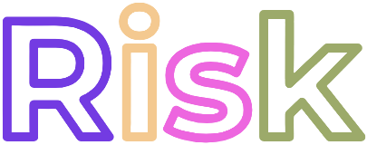

<div align="center">


 

[`rpm-ostree`](https://coreos.github.io/rpm-ostree)/[`bootc`](https://bootc.dev) system based on [Universal Blue](https://universal-blue.org)

</div>

<div align="center">

### 

### WORK IN PROGRESS // WORK IN PROGRESS // WORK IN PROGRESS // WORK
### IN PROGRESS // WORK IN PROGRESS // WORK IN PROGRESS // WORK IN
### PROGRESS // WORK IN PROGRESS // WORK IN PROGRESS // WORK IN PROGRESS

### 

</div>

#  What is this?

I want to get better at basic development, and I've always had some issue with various pre-existing distros, so I'm making one for myself. If it ends up working well I might consider making it a "proper" distro, but for now this is purely a personal project.

It uses [`niri`](https://github.com/niri-wm/niri) with [`noctalia`](https://noctalia.dev/shell). For a list of all⁽¹⁾ pre-installed software, see [below](README.md#-pre-installed-software).

#  How it works

All customisations are kept within the [`Containerfile`](Containerfile) and the [`/sysfiles`](sysfiles) directory.

The `Containerfile` obtains the latest [Silverblue](https://fedoraproject.org/atomic-desktops/silverblue) image and modifies it according to the options laid out in the `Containerfile`.

All files from [`/sysfiles`](sysfiles) are copied to `/` on the `Risk` system. If the file already exists, it is overwritten.

#  Installation

If you for some reason want to install this random assortment of code held together with duct tape and paperclips:

### Rebasing

```
# Rebasing with rpm-ostree:
`rpm-ostree rebase ostree-unverified-registry:ghcr.io/calamityfox/risk`

# Rebasing with bootc:
`sudo bootc switch --enforce-container-sigpolicy ghcr.io/calamityfox/risk:latest`
```

### Fresh install
ISO builds will happen... at some point. Right now I'm working on other things first

#  Pre-installed software

`Risk` comes with some applications pre-installed. Those labelled as `RPM` cannot be uninstalled⁽²⁾, as they're part of the immutable system image. All other apps are packaged as Flatpaks and can be removed through the software manager:

- [`librewolf`](https://librewolf.net) browser
- [`loupe`](https://apps.gnome.org/Loupe) image viewer
- [`nautilus`](https://apps.gnome.org/Nautilus) file manager (RPM)
- [`showtime`](https://apps.gnome.org/Showtime) video player
- [`thunderbird`](https://www.thunderbird.net) e-mail client 

To install additional software, use [Flathub](https://flathub.org) where possible. If a package isn't available on Flathub, you can layer it with `rpm-ostree install $PACKAGE` (not recommended), or use [`distrobox`](https://distrobox.it).

#  Notes

⁽¹⁾The list may be slightly behind actual changes. For a fully up-to-date list, see the [`build.sh`](build_files/build.sh)

⁽²⁾Technically you can uninstall RPMs with `rpm-ostree override remove $PACKAGE` but this isn't recommended outside of the build process since it can cause system instability. 

⁽³⁾ ⁽⁴⁾


#  Contact

If you encounter a bug, please report it in the [Issue Tracker](issues).

For anything else, message me on [Signal](https://signal.org), my username is  [`kes.123`](https://signal.me/#eu/nM5aRSJ1kqOL0RtXQHOtgxqk6S5baJuLUNf4RxV1cu1ZIYaKd_dNBIZPvKpvRRZO) 

# 

<div align="center">
   

  
</div>
