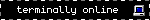

# Risk: a Linux distro
  
  
 

GNU/Linux [bootc](https://bootc.dev)/[rpm-ostree](https://coreos.github.io/rpm-ostree) image based off of [Silverblue](https://fedoraproject.org/atomic-desktops/silverblue).

The image uses [Niri](https://github.com/niri-wm/niri) and [Noctalia Shell](https://noctalia.dev/shell).

# Installation
### Fresh install
ISO builds are in the works, but aren't a priority right now.
### Rebasing
You can rebase from an existing bootc or rpm-ostree system:
```
# rebasing with bootc
sudo bootc switch --enforce-container-sigpolicy ghcr.io/calamityfox/risk:latest

# rebasing with rpm-ostree
rpm-ostree rebase ostree-unverified-registry:ghcr.io/calamityfox/risk
```
